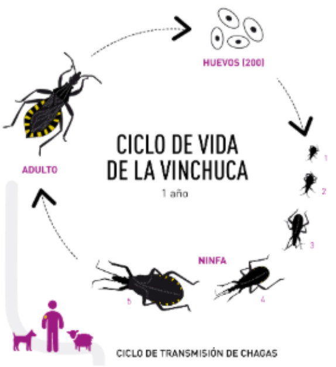

La Dirección de Epidemiología del **Ministerio de Salud de la Nación** invita a las socias y los socios de la APA a participar de la **II Jornada Federal SeVICha** (Seguimiento de la Vigilancia Intensificada de Chagas congénito y en embarazadas), dedicada al abordaje integral del Chagas congénito y en embarazadas.

El encuentro será el **miércoles 10 de junio de 2026, de 10:00 a 11:30 h**, en **modalidad virtual**. La sala se habilita a las 9:45.

## Un espacio federal de trabajo

La jornada busca reunir a los equipos que intervienen en la atención, el diagnóstico, la notificación y el seguimiento de los casos de Chagas congénito y en embarazadas, para fortalecer la articulación entre niveles y sectores y mejorar la calidad de la información. Pone especial énfasis en el rol del primer nivel de atención y en la integración de los laboratorios.

Está dirigida a equipos de salud del primer nivel de atención, de maternidad e infancia, del Programa de Chagas y de laboratorios, y a equipos de gestión de todas las jurisdicciones. La organizan, desde el Ministerio de Salud, las direcciones de Epidemiología, de Atención Primaria y Salud Comunitaria, de Zoonosis y Control de Enfermedades Transmitidas por Vectores y de Salud Perinatal, Niñez y Adolescencia, junto con el Instituto Nacional de Parasitología «Dr. Mario Fatala Chaben» (ANLIS-Malbrán).

## Agenda

- **10:00** — Apertura y presentación de la jornada.
- **10:05** — Situación epidemiológica y monitoreo de la vigilancia intensificada.
- **10:30** — Experiencias jurisdiccionales: circuitos de trabajo y estrategias de seguimiento de embarazadas con Chagas y recién nacidos expuestos.
- **11:10** — Intercambio y preguntas.
- **11:25** — Cierre y próximos pasos.

[Agenda completa de la jornada aquí](/assets/docs/agenda-jornada-sevicha-2026.pdf)

**Link de acceso:** [bit.ly/4tRyeXA](https://bit.ly/4tRyeXA)

¡Te esperamos!
