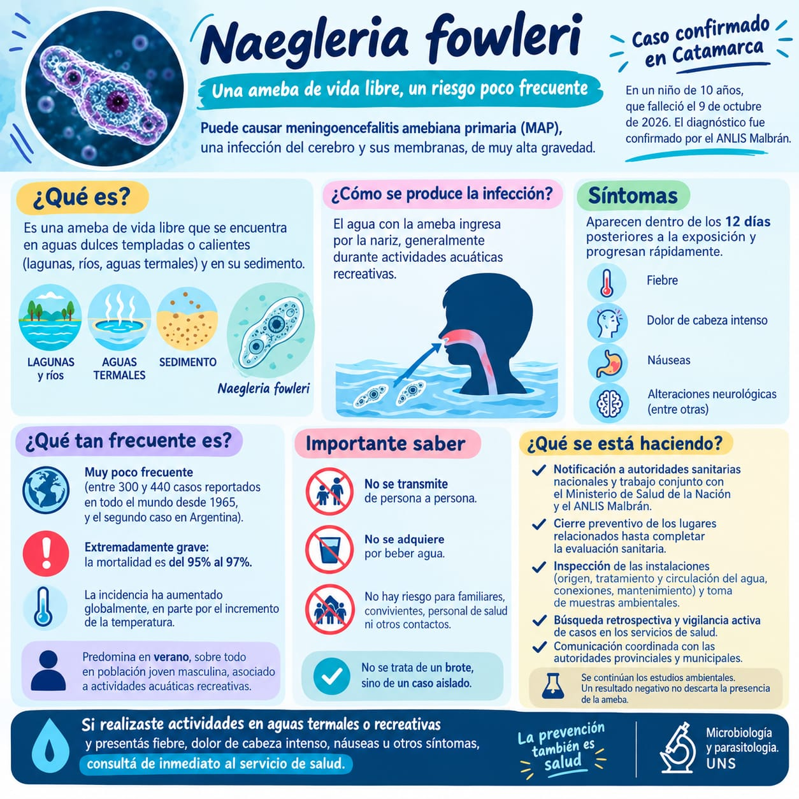

El Laboratorio Nacional de Referencia ANLIS Malbrán confirmó un caso de meningoencefalitis amebiana primaria (MAP) en la provincia de Catamarca. La causa es Naegleria fowleri, una ameba de vida libre. Es el segundo caso registrado en el país; el primero ocurrió en 2017 en la provincia de Buenos Aires.

**¿Qué es *Naegleria fowleri*?**
Es una ameba que vive en aguas dulces templadas o calientes, como lagunas, ríos y aguas termales, y en su sedimento. Puede causar la MAP, una infección del cerebro y de las membranas que lo rodean, de muy alta gravedad.

**¿Cómo se produce la infección?**
La infección ocurre cuando el agua con la ameba ingresa por la nariz, generalmente durante actividades acuáticas recreativas. No se transmite de persona a persona ni se adquiere por beber agua. Por eso no hay riesgo para familiares, convivientes ni personal de salud.

**¿Qué tan frecuente es?**
Es una enfermedad muy poco frecuente: se registraron entre 300 y 440 casos en todo el mundo desde 1965. Al mismo tiempo es extremadamente grave, con una mortalidad del 95% al 97%. Predomina en verano, sobre todo en población joven, asociada a actividades acuáticas recreativas. Su incidencia viene aumentando en el mundo, en parte por el aumento de la temperatura.

**Síntomas de alerta**
Los síntomas aparecen dentro de los 12 días posteriores a la exposición y progresan rápidamente. Los principales son fiebre, dolor de cabeza intenso, náuseas o vómitos y alteraciones neurológicas. Quien haya realizado actividades en aguas termales o recreativas y presente estos síntomas debe consultar de inmediato al servicio de salud e informar esa exposición.

**¿Cómo reducir el riesgo?**
- Mantener la nariz fuera del agua y evitar sumergir la cabeza.
- Evitar zambullidas y saltos.
- No remover el sedimento del fondo.
- Para lavados nasales, usar solo agua estéril, destilada o hervida y enfriada.

**¿Qué se está haciendo?**
Las autoridades notificaron el caso a nivel nacional y trabajan junto con el Ministerio de Salud de la Nación y el ANLIS Malbrán. Además, dispusieron el cierre preventivo de los lugares relacionados hasta completar la evaluación sanitaria. Se están inspeccionando las instalaciones y tomando muestras ambientales, y se realiza vigilancia activa y búsqueda retrospectiva de casos en los servicios de salud. Los estudios ambientales continúan; un resultado negativo no descarta la presencia de la ameba.

Desde la Asociación Parasitológica Argentina recomendamos informarse solo por fuentes oficiales. Aquí les dejamos un flyer que puede ser de utilidad.

*Fuente: Ministerio de Salud de Catamarca – ANLIS Malbrán.*
